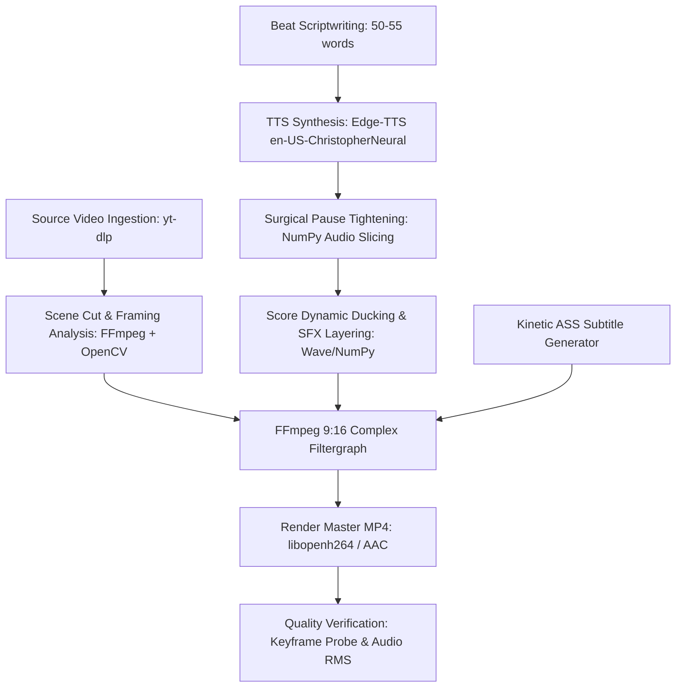

# Viral Movie Breakdown Shorts: Complete Production Pipeline Specification

## 1. Executive Summary & Core Philosophy

This specification defines the production pipeline for automated, high-retention 9:16 vertical shorts (TikTok, YouTube Shorts, Instagram Reels) based on cinematic film sequences.

### Why Standard AI Shorts Fail (The "AI Slop" Trap)
1. **Generic Stock Footage**: Using unrelated stock clips (Pexels, Pixabay) creates an unengaging, generic feel that viewers swipe past in <1 second.
2. **Artificial Narration**: Speeding up AI voices to 1.5x–2.0x makes them sound like chipmunks. Conversely, leaving raw TTS introduces 1.0–1.5s silent gaps between sentences, causing viewer drop-off.
3. **Dead Endings**: Narration stopping 3–5 seconds before the video ends creates dead air, prompting immediate swipe-aways.
4. **Poor Framing**: Center-cropping 16:9 film without tracking subjects cuts off faces, explosions, and cockpit instruments.
5. **Generic Music**: Using royalty-free elevator music instead of the film's authentic orchestral score ruins dramatic impact.

### Why This Pipeline Succeeds (Viral Retention Architecture)
- **High-Bitrate Film Footage**: Master 1080p film clips sourced directly from official distribution channels.
- **Natural Human Delivery (1.0x)**: Authentic conversational pace (`en-US-ChristopherNeural` or equivalent) with raw silence trimmed to ~120ms.
- **Zero Dead Air Ending**: Voiceover drives until 0.5s before the final cut, landing on an authoritative punchline while the score hits its peak chord.
- **Authentic Orchestral Score**: Studio master tracks (Hans Zimmer, Lorne Balfe) with dynamic volume automation (ducked during speech, swelling to 85%+ at climaxes).
- **Subject-Tracked 9:16 Reframing**: Curated horizontal offset (`cx`) per cut ensures characters and action remain centered without letterboxing.
- **Kinetic High-Contrast Subtitles**: Custom ASS typography with 70pt+ fonts, heavy outlines, and psychological color-coding.

---

## 2. System Architecture & Tech Stack



### Core Dependencies
| Tool / Library | Version / Engine | Role |
| :--- | :--- | :--- |
| **`yt-dlp`** | Latest CLI | Lossless stream extraction from official 1080p clips |
| **`ffmpeg` / `ffprobe`** | 6.x+ | Video scaling, cropping, color grading, concat, and ASS burn-in |
| **`edge-tts`** | Python SDK | Neural TTS synthesis (`en-US-ChristopherNeural`, `rate=+0%`) |
| **`numpy` / `wave`** | Python 3.10+ | Audio silence detection, surgical gap truncation, volume envelopes |
| **`opencv-python`** | Python 3.10+ | Image analysis, subject localization, center-of-mass detection |

---

## 3. The 7-Stage End-to-End Workflow

### Stage 1: Footage & Audio Sourcing
Download the highest quality 1080p movie sequence and official OST:
```bash
# Download official 1080p movie sequence
yt-dlp -f "bestvideo[height<=1080][ext=mp4]+bestaudio[ext=m4a]/best[height<=1080]" \
  --merge-output-format mp4 \
  -o "scratch/movie_source.mp4" "<YOUTUBE_URL>"

# Download official studio master soundtrack
yt-dlp -f "bestaudio" \
  -x --audio-format wav \
  -o "scratch/ost_master.wav" "<OST_URL>"
```

---

### Stage 2: Scene & Cut Point Detection
Detect cuts in the source video and map timestamps to visual moments:
```python
import subprocess, re

cmd = [
    'ffmpeg', '-i', 'scratch/movie_source.mp4',
    '-filter_complex', 'select=gt(scene\,0.35),metadata=print:file=-',
    '-f', 'null', '-'
]
proc = subprocess.Popen(cmd, stderr=subprocess.PIPE, stdout=subprocess.PIPE, text=True)
stdout, _ = proc.communicate()

cut_times = [float(m.group(1)) for m in re.finditer(r'pts_time:([0-9.]+)', stdout)]
print(f"Detected {len(cut_times)} natural cuts.")
```

---

### Stage 3: Scriptwriting Formula (The 25-Second Arc)
Word count target: **50 to 55 words** (~22 to 28 seconds total duration).

| Beat | Timestamp | Dramatic Function | Example (Top Gun: Maverick) |
| :--- | :--- | :--- | :--- |
| **Beat 1** | `0.0s - 2.3s` | **High-Stakes Hook** | *"The Navy said the mission was suicide."* |
| **Beat 2** | `2.3s - 6.5s` | **The Extreme Challenge** | *"Fly an F-18 at 660 knots through a winding canyon, below radar..."* |
| **Beat 3** | `6.5s - 10.5s` | **Impossible Target** | *"...and hit a three-meter target in under two minutes and fifteen seconds."* |
| **Beat 4** | `10.5s - 12.7s` | **The Disbelief** | *"Every pilot called it impossible."* |
| **Beat 5** | `12.7s - 15.8s` | **The Rebel Action** | *"So Maverick stole a fighter jet to prove them wrong."* |
| **Beat 6** | `15.8s - 20.7s` | **Climax Dive / Action** | *"Pulling nine Gs between razor-sharp cliffs, he dives vertical into the crater."* |
| **Beat 7** | `20.7s - 23.6s` | **The Impact Strike** | *"Miracle number one. Direct hit."* |
| **Beat 8** | `23.6s - 28.2s` | **The Kicker / Punchline** | *"Two minutes, fourteen seconds. Class dismissed."* |

> [!IMPORTANT]
> **Zero Dead Air Rule**: The final punchline (Beat 8) must finish speaking within 0.5s of the video ending. The video must end immediately after the final line on the musical resolution chord.

---

### Stage 4: Voiceover Synthesis & Surgical Silence Truncation
Instead of speeding up the voice (which causes robotic artifacts), synthesize lines individually at natural `rate=+0%`, trim leading/trailing padding, and assemble them with exactly **120ms pauses**:

```python
import edge_tts, asyncio, subprocess, wave, os
import numpy as np

lines = [
    ("The Navy said the mission was suicide.", "line_01.mp3"),
    ("Fly an F-18 at 660 knots through a winding canyon...", "line_02.mp3"),
    ("...and hit a three-meter target in under two minutes and fifteen seconds.", "line_03.mp3"),
    ("Every pilot called it impossible.", "line_04.mp3"),
    ("So Maverick stole a fighter jet to prove them wrong.", "line_05.mp3"),
    ("Pulling nine Gs between razor-sharp cliffs, he dives vertical into the crater.", "line_06.mp3"),
    ("Miracle number one. Direct hit.", "line_07.mp3"),
    ("Two minutes, fourteen seconds. Class dismissed.", "line_08.mp3"),
]

# 1. Synthesize lines individually
async def synth_all():
    for text, fname in lines:
        c = edge_tts.Communicate(text, 'en-US-ChristopherNeural', rate='+0%')
        await c.save(fname)
asyncio.run(synth_all())

# 2. Trim silence & assemble with exact 120ms pauses
sr = 44100
processed = []
for _, fname in lines:
    cmd = ['ffmpeg', '-y', '-i', fname, '-ar', str(sr), '-ac', '1', '-f', 'wav', 'pipe:1']
    res = subprocess.run(cmd, stdout=subprocess.PIPE, check=True)
    samples = np.frombuffer(res.stdout[44:], dtype=np.int16).astype(np.float32) / 32768.0

    # Energy-based silence trimming
    win = int(sr * 0.02)
    energy = [np.mean(samples[i:i+win]**2) for i in range(0, len(samples), win)]
    threshold = 0.0005

    st = next((max(0, i * win - int(sr * 0.04)) for i, e in enumerate(energy) if e > threshold), 0)
    en = next((min(len(samples), (i + 1) * win + int(sr * 0.04)) for i in range(len(energy)-1, -1, -1) if energy[i] > threshold), len(samples))
    processed.append(samples[st:en])

pause_len = int(sr * 0.12)
master_vox = []
for i, chunk in enumerate(processed):
    master_vox.extend(chunk)
    if i < len(processed) - 1:
        master_vox.extend(np.zeros(pause_len, dtype=np.float32))
```

---

### Stage 5: Sound Design & Score Mixing
The master audio blends three layers:
1. **Voiceover**: Dominant 1.35x volume.
2. **Authentic Film Score**:
   - 36% volume under narration.
   - Dynamic swell to 82%+ at the final climax (last 2.5s).
3. **Foley / Explosion Impact**:
   - Sourced from the film at the impact timestamp and mixed at 75% volume.
4. **Master Peak Limiter**: Ensures maximum loudness without distortion (`peak <= 0.95`).

---

### Stage 6: Kinetic ASS Subtitle System
Subtitles are generated directly into Advanced SubStation Alpha (`.ass`) with 4 distinct visual styles:

```ini
[V4+ Styles]
Format: Name, Fontname, Fontsize, PrimaryColour, SecondaryColour, OutlineColour, BackColour, Bold, Italic, Underline, StrikeOut, ScaleX, ScaleY, Spacing, Angle, BorderStyle, Outline, Shadow, Alignment, MarginL, MarginR, MarginV, Encoding
Style: YellowHook,Liberation Sans,70,&H0000E5FF,&H000000FF,&H00000000,&H80000000,1,0,0,0,105,105,1,0,1,8,0,2,40,40,360,1
Style: WhiteBold,Liberation Sans,68,&H00FFFFFF,&H000000FF,&H00000000,&H80000000,1,0,0,0,100,100,1,0,1,7,0,2,40,40,360,1
Style: RedImpact,Liberation Sans,72,&H00303BFF,&H000000FF,&H00000000,&H80000000,1,0,0,0,108,108,1,0,1,8,0,2,40,40,360,1
Style: CyanClimax,Liberation Sans,76,&H00FFFF00,&H000000FF,&H00000000,&H80000000,1,0,0,0,110,110,2,0,1,9,0,2,40,40,360,1
```

*Color Key (BGR Hex Format)*:
- `&H0000E5FF`: Vibrant Gold/Yellow (Hooks, action verbs)
- `&H00303BFF`: High-intensity Crimson (Stakes, death, danger)
- `&H00FFFFFF`: Pure White (Dialogue, setup)
- `&H00FFFF00`: Electric Cyan (Climax, punchline)

---

### Stage 7: Video Assembly & Subject-Tracked Reframing
A 16:9 source (1920×1080) scaled to height 1920 becomes **3413×1920**. To produce a 1080×1920 frame without black bars, crop 1080 horizontally using an offset:

$$\text{crop\_x} = (in\_w - 1080) \times cx$$

- $cx = 0.50$: Exact center.
- $cx = 0.35$: Left-biased (e.g. radar map or character on left).
- $cx = 0.60$: Right-biased (e.g. character or instrument on right).

#### FFmpeg Filtergraph Construction:
```python
cuts = [
    # (source_start, duration, crop_cx)
    (2.5, 2.26, 0.35),   # Briefing map (left-biased)
    (33.0, 4.28, 0.50),  # Low-altitude canyon skim
    (64.0, 4.04, 0.52),  # Inverted bank
    (92.0, 2.16, 0.55),  # Recruits in disbelief
    (16.0, 3.08, 0.56),  # Maverick cockpit focus
    (110.0, 2.18, 0.50), # Pop-up climb
    (116.5, 2.66, 0.50), # Inverted crater dive
    (136.5, 2.94, 0.50), # Bunker fireball
    (159.5, 2.00, 0.50), # Cyclone stunned
    (171.2, 2.60, 0.50), # Victory roll into clouds
]

filter_chains = []
for idx, (ss, dur, cx) in enumerate(cuts):
    filter_chains.append(
        f"[0:v]trim=start={ss}:duration={dur},setpts=PTS-STARTPTS,"
        f"scale=-1:1920,crop=1080:1920:(in_w-1080)*{cx}:0,"
        f"eq=contrast=1.16:brightness=0.02:saturation=1.22[v{idx}];"
    )

concat_inputs = "".join([f"[v{i}]" for i in range(len(cuts))])
concat_filter = f"{concat_inputs}concat=n={len(cuts)}:v=1:a=0[v_concat];"

final_v_chain = (
    "[v_concat]"
    "drawbox=x=0:y=180:w=1080:h=90:color=black@0.7:t=fill,"
    "drawtext=text='TOP GUN - MAVERICK':font='Liberation Sans':fontsize=32:fontcolor=white:x=(w-text_w)/2:y=208,"
    "drawtext=text='THE IMPOSSIBLE CANYON RUN':font='Liberation Sans':fontsize=20:fontcolor=#00E5FF:x=(w-text_w)/2:y=188,"
    "ass=topgun_captions.ass[out_v]"
)
```

---

## 4. Crucial Agent Constraints & Edge Cases

1. **FFmpeg `drawtext` Colons**:
   - In FFmpeg filters, unescaped colons `:` are treated as option separators.
   - Never write `text='TOP GUN: MAVERICK'`. Use `text='TOP GUN - MAVERICK'` or `text='TOP GUN\: MAVERICK'`.
2. **Audio/Video Exact Match**:
   - If audio is 28.20 seconds, the sum of cut durations must equal 28.20 seconds.
   - Set `-t 28.2` on the final FFmpeg render to ensure zero drift.
3. **No Voice Pitch Alteration**:
   - Do not use `rate=+50%` or `rate=+100%`.
   - Keep rate between `+0%` and `+5%` and achieve pace through waveform pause elimination.
4. **Zero Lingering Dead Air**:
   - Never stop speech 3 seconds before video ends.
   - The punchline must drive through the final second.
